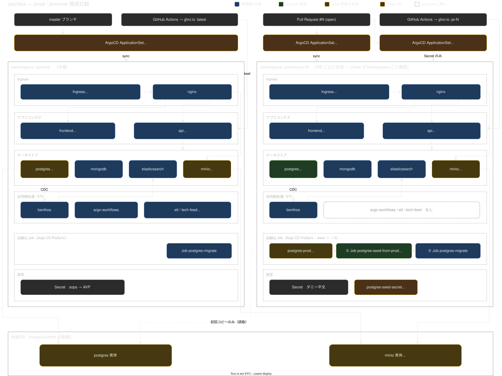

# preview 環境

`preview` ラベルを付けた open な PR 1本につき 1環境を `pechka-pr-<N>` namespace に自動で立ち上げる。
PR を立てれば生え、close / merge すれば namespace ごと消える。

- URL: `https://pechka-pr-<N>.wpcapp.net`
- VRT レポート: `https://pechka-pr-<N>.wpcapp.net/vrt-report/index.html`
- Storybook: `https://pechka-pr-<N>.wpcapp.net/storybook/`

> ※ 図中の MinIO（prod 実体共有）などは旧構成のままであり、現行の MinIO や上書き対象などの構成は下の「運用メモ」のとおりである。

## 運用メモ

- `nuage-cluster` 側の ApplicationSet（`pechka-preview-appset.yaml` / `pechka-preview-secret-appset.yaml`）により、`pechka-pr-<N>` と `pechka-pr-<N>-secret` の 2 つの Application がデプロイされる。`pechka-api` / `pechka-frontend` / `pechka-vrt-report` / `pechka-storybook-report` / `etl-*` / `aivisspeech-engine` / `tech-feed-*` のイメージタグは `:pr-<N>` へ、Ingress のホスト名と Namespace は PR 番号ごとに自動上書きされる。
- PR 検知は最大 180 秒間隔。CI のイメージビルド完了まで `ImagePullBackOff` になるが、CI 完走後に解消する。環境が立たないときは、まず `pechka-pr-<N>` と `pechka-pr-<N>-secret` の両方の Application があるか確認する（Secret 側が無いと seed Job が PreSync で止まる）。
- DB を prod の最新に取り直したいときは、該当 Application を Sync し直せばよい（`postgres-seed-from-prod` Job は `BeforeHookCreation` で再実行される）。
- S3（`minio` Service）は PR ごとの使い捨てローカルコンテナ（`minio-local.yaml` の `adobe/s3mock`、空スタート）であり、書き込みはローカルに閉じ、未存在リソースの読み取り（GET / HEAD）のみ本番 swfs へ透過フォールバックする（`nginx` `@minio_prod_fallback`）。
